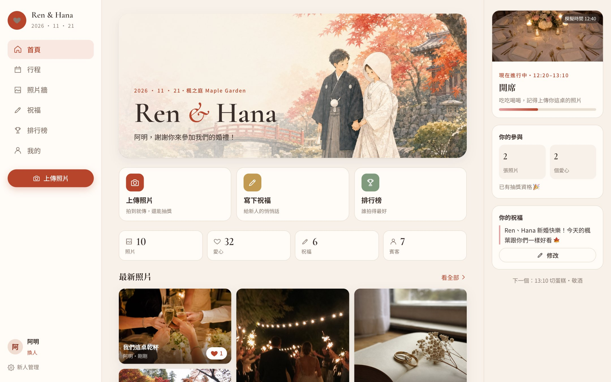
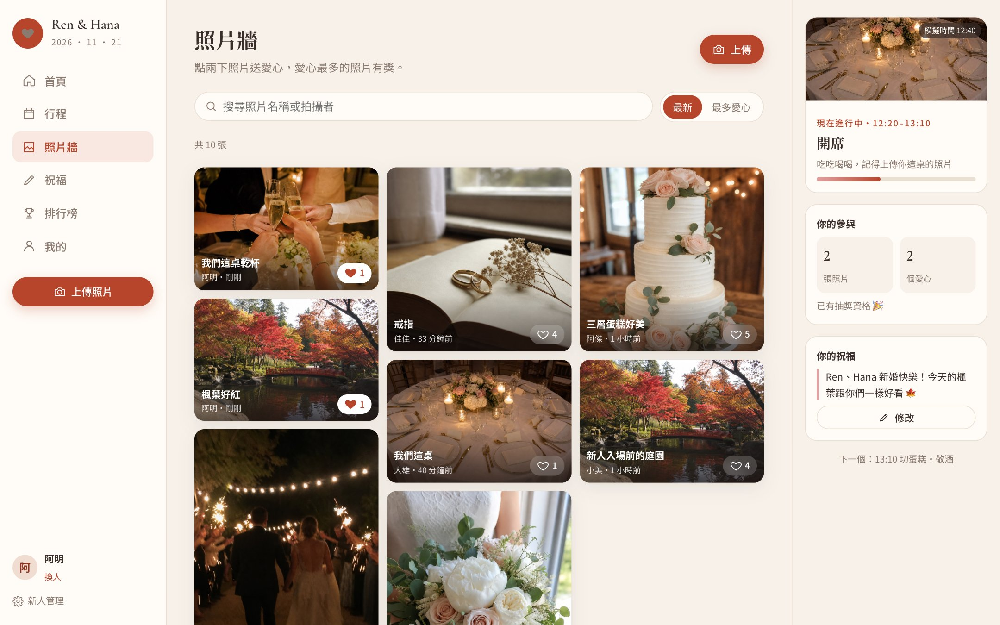
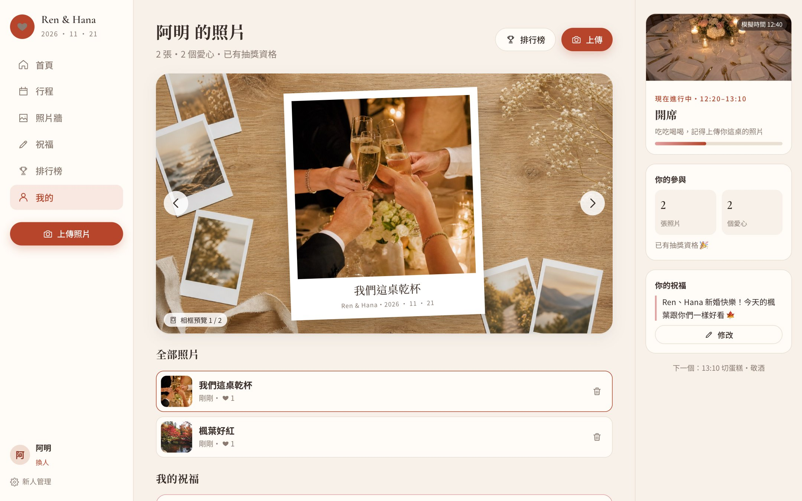
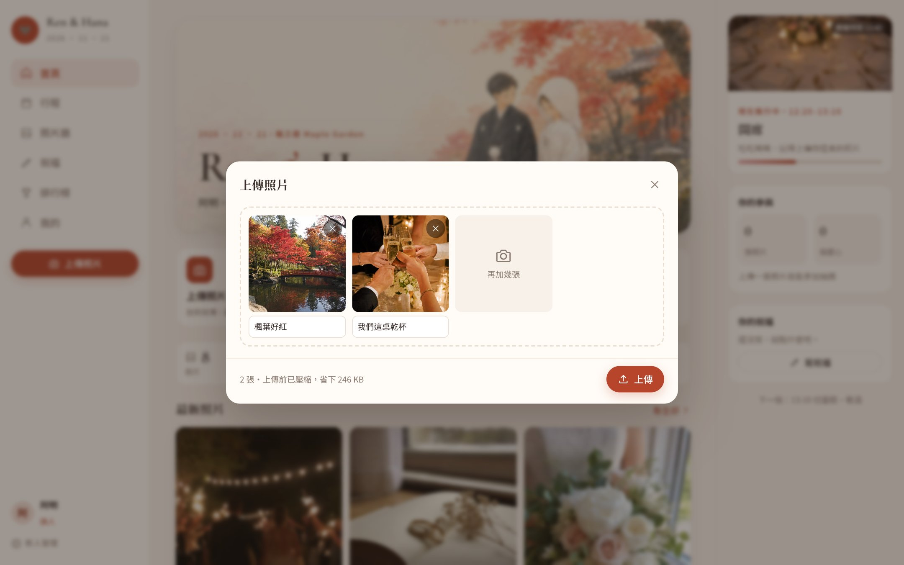
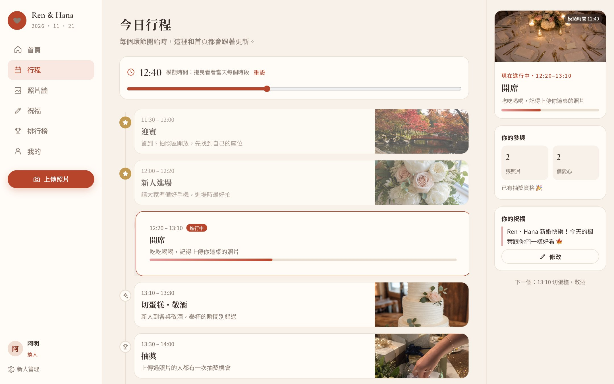
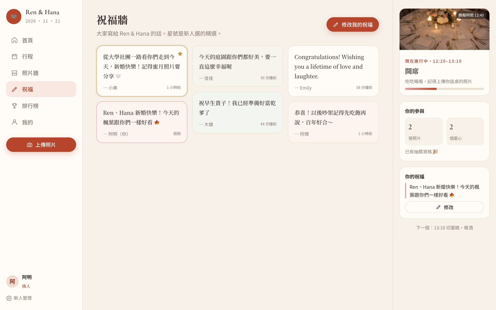
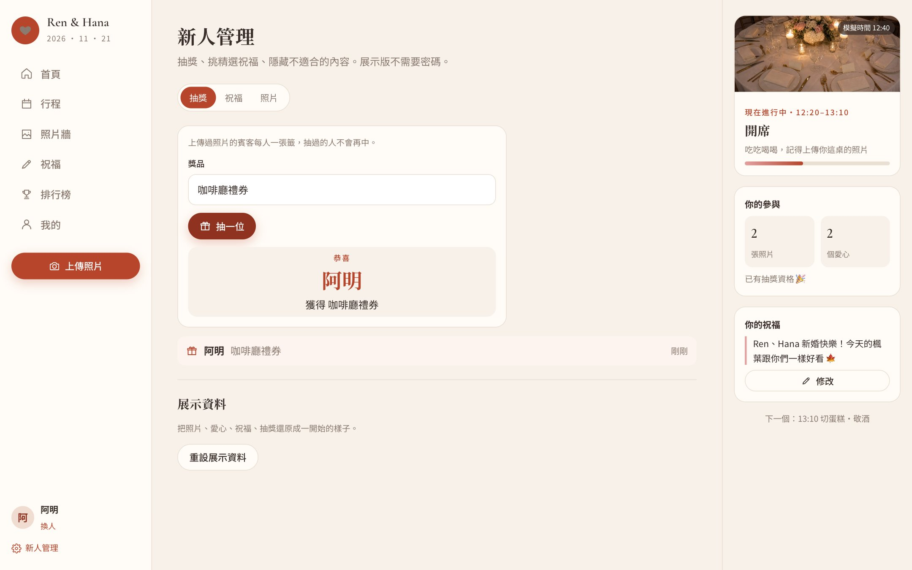
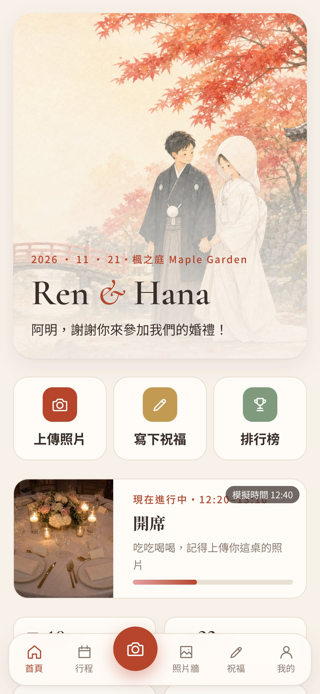
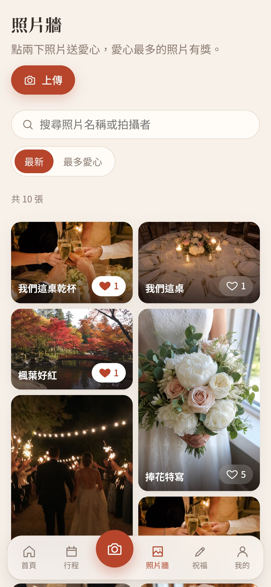
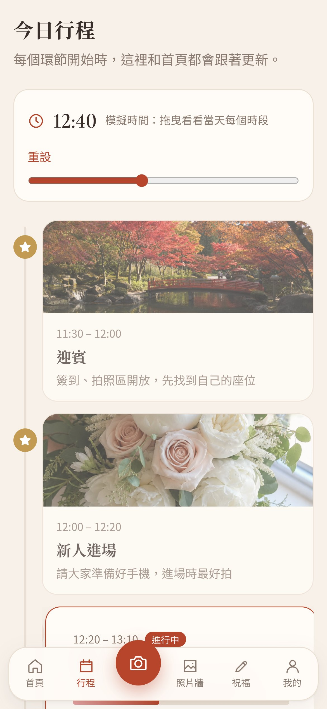

# 婚禮賓客互動網頁

婚禮當天給賓客用手機開的網頁：看行程、上傳照片、點兩下送愛心、寫祝福、看排行榜，新人在後台抽獎。

第一版用在我自己的婚禮，後端已經關閉；這一版重寫成**不需要後端也能完整操作的展示版**，資料存在瀏覽器裡。

> 畫面中的新人「Ren & Hana」、賓客和所有照片都是虛構的，圖片全部由 AI 生成。



## 功能

| 照片牆：點兩下送愛心、搜尋、依愛心排序 | 相框預覽：自己的照片放進拍立得相框 |
|---|---|
|  |  |
| **上傳：多張、拖曳、上傳前在瀏覽器壓縮** | **行程：跟著時間自動標出現在進行到哪** |
|  |  |
| **祝福牆：每人一則，可修改，新人選精選** | **新人管理：抽獎、精選祝福、隱藏內容** |
|  |  |

<p align="center">
  
  
  
</p>

賓客幾乎都用手機，所以手機版是主要設計：底部分頁列、正中間的拍照上傳鈕、上傳視窗從下方滑出、照片可左右滑動切換。

## 幾個設計重點

- **按愛心立即反應**：畫面先更新，伺服器失敗再退回（樂觀更新）；點兩下照片會跳出愛心動畫。
- **上傳前先壓縮**：手機原圖動輒數 MB，在瀏覽器用 canvas 縮到長邊 1600px 再上傳，現場 Wi-Fi 也撐得住，畫面會顯示省下多少流量。
- **行程跟著時間走**：婚禮當天依現在時間標出進行中的環節與進度；其他日子展示版改用模擬時間，可以拖曳看每個時段。
- **抽獎公平**：上傳過照片的人每人一張籤，同一人不會中兩次。
- **後端換得掉**：畫面只透過 `WeddingApi` 介面（`src/api/types.ts`）存取資料；展示版的實作在 `src/api/demo.ts`，用 IndexedDB 保存，重新整理後資料還在。
- **無障礙**：原生 `<dialog>` 處理焦點與 Esc、圖片燈箱支援鍵盤左右鍵、愛心按鈕有 `aria-pressed`、尊重「減少動態效果」設定。

## 技術

React 19、TypeScript（strict）、Vite、React Router（hash 路由，任何靜態主機都能放）、原生 CSS、Vitest。沒有 UI 套件。

```
src/
  api/        WeddingApi 介面、瀏覽器內的展示後端、IndexedDB 存取
  state/      登入的賓客、資料重新整理、婚禮時鐘、提示訊息
  lib/        行程計算、圖片壓縮、時間格式
  components/ 版面、對話框、照片卡片與燈箱、上傳、祝福
  pages/      首頁、行程、照片牆、祝福牆、排行榜、我的、新人管理
```

## 指令

```bash
npm install
npm run dev           # http://localhost:5173
npm test              # 展示後端與行程計算的測試
npm run build         # 打包到 dist/
npm run screenshots   # 先開 npm run dev，重拍 README 截圖
```
