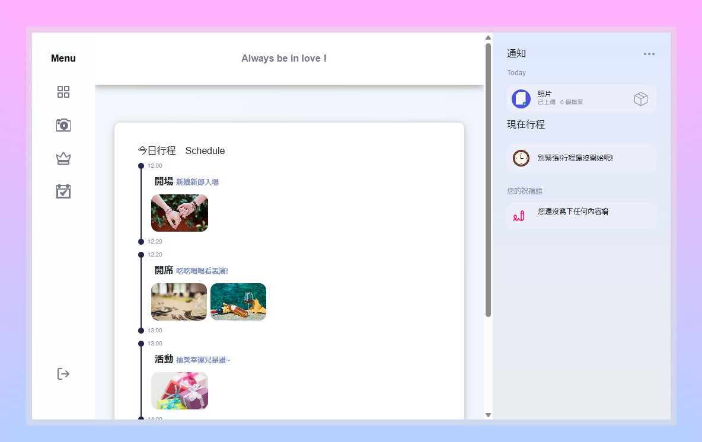
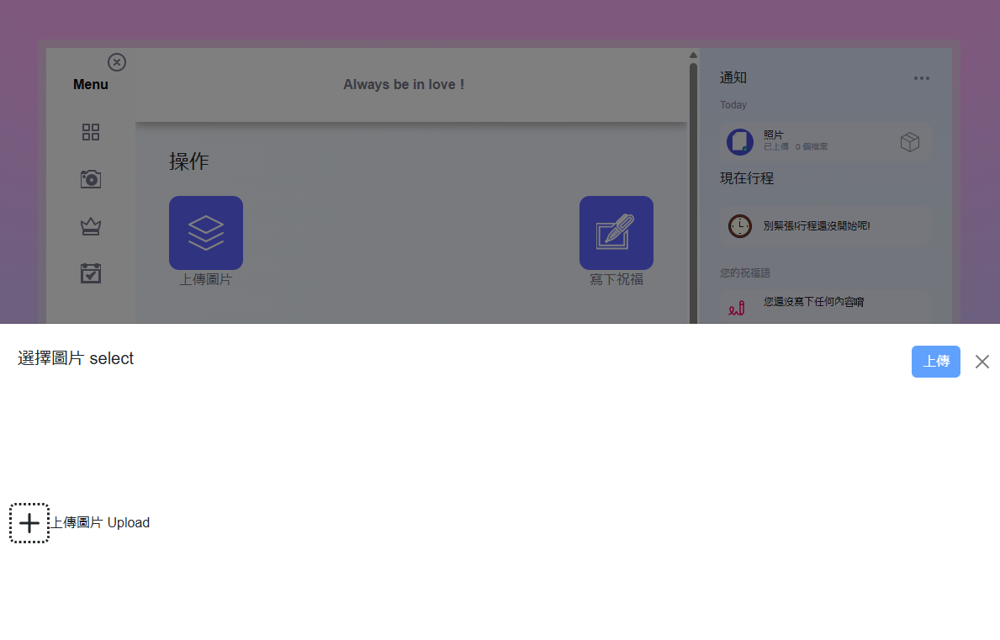
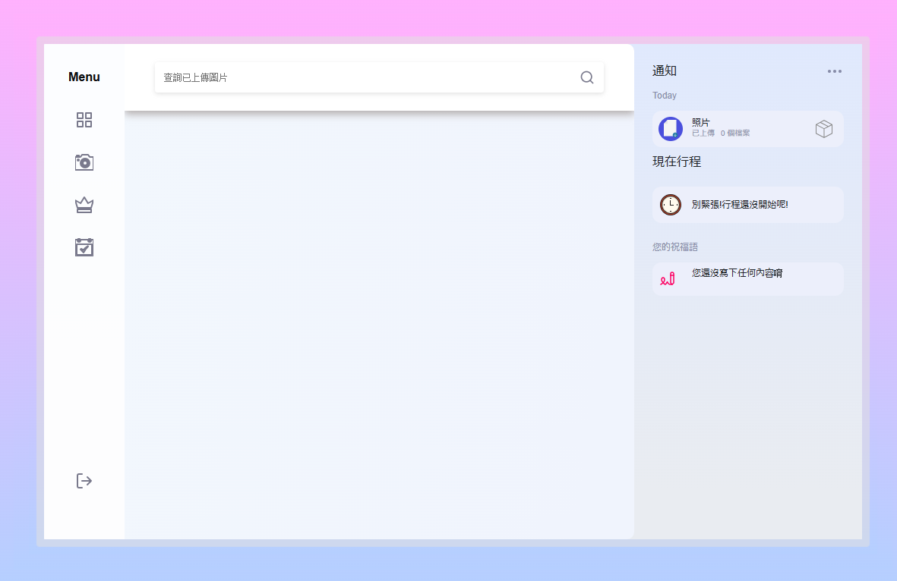
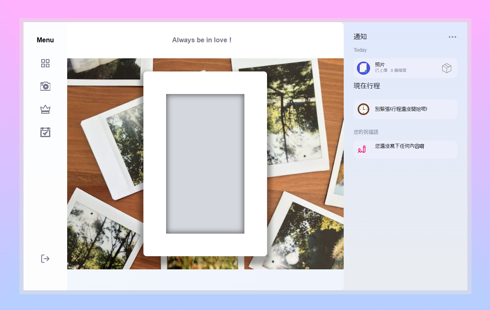
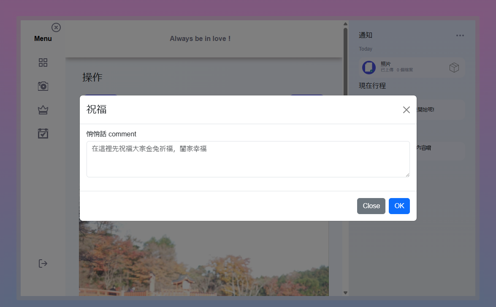
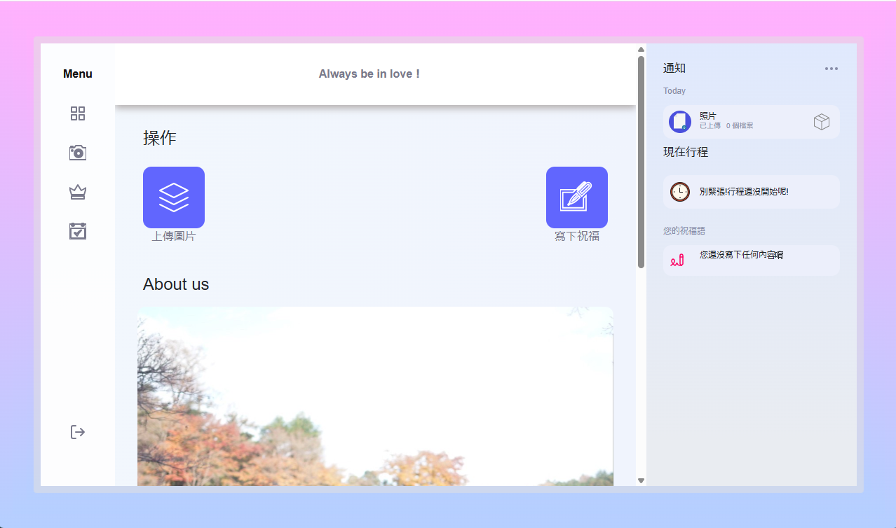
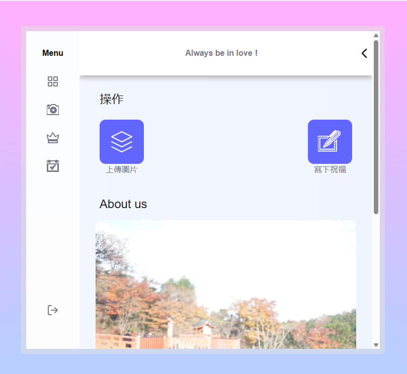
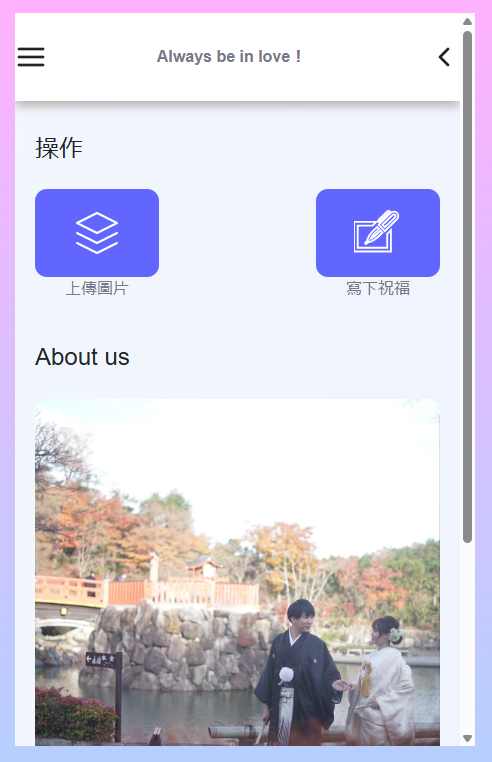

# 婚禮應用

## 介紹

這是一個專為婚禮當日賓客設計的應用程序，旨在提升賓客的參與度和互動性。賓客可以登入應用，查看當天的行程表，並上傳他們捕捉到的精彩瞬間。這個應用不僅能夠簡單地管理相片集，還能讓賓客之間互動，增強婚禮的氛圍。

## 主要功能

### 1. 行程表查看
賓客可以輕鬆查看婚禮當天的行程安排，確保不錯過任何重要時刻。行程表會顯示每個環節的開始時間和地點，讓賓客能夠提前做好準備。

### 2. 照片上傳
賓客可以將拍攝的照片上傳到應用中，這些照片將會在應用的相冊中展示。這不僅讓賓客能夠分享他們的視角，還能讓所有人共同回顧婚禮的美好瞬間。

### 3. 照片排名
所有上傳的照片將會在排名中與其他賓客拍攝的照片一同展示。賓客可以對喜歡的照片點擊“喜歡”，最終根據喜歡數來決定誰拍的照片最好。這種競爭性不僅增加了趣味性，還鼓勵賓客積極參與拍攝。

### 4. 小禮物獎勵
為了提升賓客的參與度，應用將根據照片的喜歡數來頒發小禮物，鼓勵賓客積極參與。這不僅能增強賓客的互動，還能讓他們感受到被重視和獎勵。

### 5. 相冊模式
賓客可以在相冊模式中查看拍攝的照片，並預覽這些照片在相框中的效果。這種視覺化的展示方式讓賓客能夠更好地欣賞和分享他們的作品，並激發他們的創意。

### 5. 祝福留言
可寫下對新人的祝福語，並且所有賓客也是可以看到祝福內容，當然為了篩選出最佳祝福語，這個應用也有管理員模式，可針對內容進行調整。

## 響應式設計

本應用採用了響應式設計，確保在不同尺寸的設備上都能提供良好的用戶體驗。無論是在手機、平板還是桌面設備上，應用的布局都會自動調整，以適應不同的屏幕尺寸，讓賓客能夠隨時隨地輕鬆使用。

## 實際應用

這個應用已經在實際婚禮中使用過，並且目前的代碼仍然保持連接到真實的 API。雖然後端目前處於關閉狀態，無法展示許多功能，但這個應用的設計和功能已經經過實際測試，並獲得了良好的反饋。

## 設計理念

本應用的設計旨在提供簡潔而直觀的用戶體驗。使用了現代化的 UI 元素和響應式設計，確保在各種設備上都能流暢運行。背景使用了柔和的漸變色，營造出浪漫的氛圍，讓用戶在使用過程中感受到婚禮的喜悅。

## 技術棧

- **前端**：React, TypeScript, SCSS
- **路由**：React Router
- **樣式**：Bootstrap, 自定義樣式

## 優點

- **增強互動性**：賓客之間可以通過照片上傳和點贊互動，增強了婚禮的社交氛圍。
- **簡化管理**：賓客可以輕鬆管理自己的照片，並查看其他賓客的作品，簡化了婚禮的回顧過程。
- **提升參與感**：小禮物獎勵機制鼓勵賓客積極參與，讓他們感受到婚禮的熱情和歡樂。
- **視覺化展示**：相冊模式提供了直觀的照片展示方式，讓賓客能夠更好地欣賞和分享他們的拍攝作品。

感謝您查看此項目！期待您的反饋。